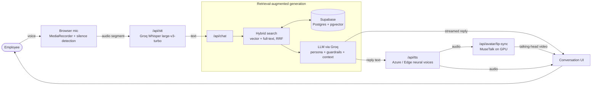

<div align="center">

# PwC Tunisia · AI Avatar Assistant


-ff6d00)

</div>

---

## 🎬 Demo

 YouTube link
     https://youtu.be/r9Ovj3gaRNc 

## Table of contents

- [What it is](#what-it-is)
- [Key features](#key-features)
- [How it works](#how-it-works)
- [Tech stack](#tech-stack)
- [Data model](#data-model)
- [Roles and access control](#roles-and-access-control)
- [Getting started](#getting-started)
- [Environment variables](#environment-variables)
- [Project structure](#project-structure)
- [Known limitations](#known-limitations)
- [Roadmap](#roadmap)
- [Author](#author)

---

## What it is

Employees at PwC Tunisia lose time hunting for answers across policies, procedures and internal documents. This project replaces that search with a **conversation**: an employee picks an avatar, speaks a question in **English, French or Arabic**, and the avatar answers out loud, in its own voice and persona, grounded in documents the firm has approved.

It has two sides:

- **Employee experience** (`/experience`, `/conversation`): a cinematic landing page and a real-time voice conversation screen.
- **Admin studio** (`/admin`): where administrators create avatars, define personas and guardrails, upload knowledge, review conversations, run test suites and manage users.

Answers are **retrieval-augmented**. The assistant answers from the knowledge sources attached to the avatar, and escalates when it can't.

---

## Key features

### 🗣️ For employees
- **Voice-first conversation**: speak naturally, hear the answer, with a live transcript.
- **Three languages**: English, French and Arabic voices that code-switch with French the way people actually speak.
- **Lip-synced avatar video** generated per reply (MuseTalk).
- **Grounded answers** from the firm's own documents, with graceful escalation when the knowledge base has no answer.
- **Text fallback**: type instead of speaking at any point.

### 🛠️ For administrators
- **Avatar management**: appearance, voice and scene, with draft/active status.
- **Persona editor**: role, department, expertise, communication style and **guardrails** (forbidden topics, escalation instructions), with a live behaviour preview.
- **Avatar combinations**: pair any avatar with any persona and a set of knowledge sources.
- **Knowledge center**: upload PDF, DOCX, TXT, MD and CSV files or ingest URLs into folders ("knowledge sources"). Documents are chunked, embedded and indexed automatically.
- **Conversation center**: review every session, its transcript, duration, language and escalation status.
- **Testing lab**: run question sets against an avatar and review pass/fail.
- **User management**: create users, assign **Employee** or **Administrator** roles, suspend or delete accounts.

---

## How it works



**One conversation turn**

1. **Listen.** The browser records the mic and cuts a segment after a pause in speech (RMS-based silence detection).
2. **Transcribe.** The segment goes to Whisper with a language hint, which gives much better French and Arabic accuracy than the browser's built-in speech API.
3. **Retrieve.** The question is embedded (BAAI/bge-m3, 1024 dimensions) and run through **hybrid search**: pgvector similarity plus French full-text search, fused with Reciprocal Rank Fusion. Search is scoped in SQL to the knowledge sources linked to the active persona, so an avatar can never leak another avatar's documents.
4. **Generate.** A system prompt is built from the persona (role, tone, guardrails, escalation rules) and a **language lock**, so the reply stays in the language the user is speaking. Retrieval confidence is measured, and low-confidence turns can trigger escalation.
5. **Speak.** The reply is converted to speech with a language- and gender-matched neural voice (`ar-TN-*` for Tunisian Arabic).
6. **Animate.** The audio is sent to a MuseTalk service that returns a lip-synced avatar video, which plays alongside the transcript.

Every turn is logged to `conversation_messages` with retrieval metrics, so admins can audit quality.

---

## Tech stack

| Layer | Technology |
|---|---|
| **Frontend + backend** | Next.js 16 (App Router, API Routes), React, TypeScript |
| **Styling / motion** | Tailwind CSS v4, Framer Motion, lucide-react |
| **Database** | Supabase: Postgres with **pgvector** and full-text search |
| **Auth** | Supabase Auth (email and password, optional Microsoft Entra SSO), role-based access via `proxy.ts` |
| **LLM (chat)** | Groq-hosted open models (`gpt-oss-120b` / `gpt-oss-20b`), selectable per persona |
| **Speech-to-text** | Groq Whisper `large-v3-turbo` |
| **Text-to-speech** | Azure Speech or Microsoft Edge neural voices (EN / FR / `ar-TN`), with automatic fallback |
| **Embeddings** | `BAAI/bge-m3` (1024-d, multilingual) via Cloudflare Workers AI or Hugging Face |
| **Lip-sync avatar** | MuseTalk served from a GPU notebook, tunnelled with ngrok |
| **Document ingestion** | `unpdf` (PDF), `mammoth` (DOCX), plain-text loaders, custom chunker |

**Design note:** the stack is deliberately built on **free-tier and open components** (Groq, Cloudflare, Edge TTS, MuseTalk), so it can be demoed and iterated on at near-zero cost. Each provider sits behind a small interface (`lib/llm`, `lib/ingestion`, `lib/musetalk`), so swapping one for a paid or on-prem alternative is a contained change.

---

## Data model

```
avatars ──┐
          ├── avatar_combinations ──► knowledge_sources ──► knowledge_files ──► knowledge_chunks (vector + tsvector)
personas ─┘            │
                       ▼
                 conversations ──► conversation_messages
                       │
                     tests

auth.users ──► profiles (role: employee | admin, status: Active | Suspended)
```

- **avatars**: name, image/video, owner, body type, status.
- **personas**: role, prompt, QnA model, creativity, status, version, department, gender.
- **avatar_combinations**: an avatar + a persona + the knowledge sources it may draw from.
- **knowledge_sources / files / chunks**: folders, uploaded files, and the embedded chunks used for retrieval.
- **conversations / conversation_messages**: sessions and their full transcripts, with language, duration and escalation status.
- **profiles**: one row per user, extending `auth.users` with role and status.

---

## Roles and access control

| Role | After sign-in | Can open |
|---|---|---|
| **Employee** | Straight to `/experience` | `/experience`, `/conversation` |
| **Administrator** | `/select-role` (choose experience or admin) | Everything, including `/admin/**` |
| **Suspended** | Back to sign-in | Nothing, effective immediately |

Access is enforced in **one place**: `proxy.ts` (Next.js 16's middleware). It checks the session and reads role and status from `profiles` on every request, covering both pages and `/api/admin/*`. Admin-sensitive routes **re-check** server-side as defence in depth. In the database:

- Row-level security lets users read only **their own** profile; all writes go through the service-role admin API.
- New users are always created as `employee`. Roles are never read from user-editable metadata.
- A trigger prevents deleting, demoting or suspending the **last active admin**.

---

## Getting started

### Prerequisites
- Node.js 20+ (developed on v24)
- A [Supabase](https://supabase.com) project (with the `vector` extension enabled)
- A free [Groq](https://console.groq.com) API key
- *(Optional)* A Cloudflare Workers AI token for embeddings, and a MuseTalk endpoint for lip-sync

### 1. Clone and install
```bash
git clone https://github.com/<your-username>/<your-repo>.git
cd <your-repo>
npm install
```

### 2. Configure environment
```bash
cp .env.example .env.local   # then fill in the values, see the table below
```

### 3. Set up the database
Apply the SQL migrations in `supabase/migrations/` **in order** via the Supabase SQL Editor (or the Supabase CLI).

<!-- TODO: add the earlier schema/migration files (tables, pgvector, match_knowledge_chunks) to supabase/migrations/ so a fresh clone can be fully provisioned. -->

### 4. Create your first administrator
1. In Supabase, go to **Authentication → Users → Add user**, enter an email and password, and tick **Auto Confirm User**.
2. Promote that user in the SQL Editor:
   ```sql
   update public.profiles
   set role = 'admin', full_name = 'Your Name'
   where lower(email) = lower('you@company.com');
   ```
3. Also **disable public sign-ups** under Authentication → Providers → Email, so only admins can create accounts.

### 5. Run
```bash
npm run dev
```
Open <http://localhost:3000> and sign in. Administrators then land on the role chooser, and employees go straight to the experience.

> **Windows tip:** if routes 404 or assets look stale after pulling changes, stop the server, delete the `.next` folder and restart.

---

## Environment variables

Create `.env.local` (never commit it).

| Variable | Required | Purpose |
|---|:---:|---|
| `NEXT_PUBLIC_SUPABASE_URL` | ✅ | Supabase project URL |
| `NEXT_PUBLIC_SUPABASE_ANON_KEY` | ✅ | Public anon key (used with RLS and sessions) |
| `SUPABASE_SERVICE_ROLE_KEY` | ✅ | **Server only**: admin API, ingestion, role lookups |
| `GROQ_API_KEY` | ✅ | Chat completions and Whisper speech-to-text |
| `CHAT_MODEL_QUALITY` / `_BALANCED` / `_FAST` | – | Override the model behind each persona tier |
| `STT_MODEL` | – | Defaults to `whisper-large-v3-turbo` |
| `EMBEDDING_PROVIDER` | – | `cloudflare` or `huggingface` (auto-detected if unset) |
| `CF_ACCOUNT_ID`, `CF_API_TOKEN` | – | Cloudflare Workers AI embeddings (free tier) |
| `HF_API_KEY` | – | Hugging Face embeddings alternative |
| `TTS_PROVIDER` | – | `azure`, `edge` or `google` (default: auto with fallback) |
| `AZURE_SPEECH_KEY`, `AZURE_SPEECH_REGION` | – | Azure Speech, if used |
| `TTS_VOICE_{EN,FR,AR}_{FEMALE,MALE}` | – | Override the default voice per language and gender |
| `KAGGLE_MUSETALK_URL` | – | Public URL of the MuseTalk lip-sync service. Without it, the app runs voice-only. |

> ⚠️ `SUPABASE_SERVICE_ROLE_KEY` bypasses all row-level security. Keep it server-side and out of version control.

---

## Project structure

```
app/
  page.tsx                  Sign-in
  select-role/              Admin-only chooser (experience or admin)
  experience/               Landing page and avatar picker
  conversation/             Real-time voice conversation
  admin/                    Avatars · Personas · Knowledge · Conversations · Testing · Users · Settings
  auth/                     continue · callback · signout
  api/
    chat/  stt/  tts/       Conversation pipeline
    avatar/                 Lip-sync and status
    conversations/          Session lifecycle
    admin/                  CRUD for every admin resource, incl. users
components/
  admin/  home/  voice/  chat/
hooks/                      useSpeechToText · useTextToSpeech · useChatStream
lib/
  llm/                      Chat client, system prompt, pipeline, metrics, STT/TTS
  ingestion/                Extract → chunk → embed → retrieve
  musetalk/                 Lip-sync client
  auth/                     Roles and server guards
  supabase/                 Server, browser and service-role clients
proxy.ts                    Route-level access control
supabase/migrations/        SQL migrations
```

---

## Known limitations

- **Latency.** A turn chains STT → retrieval → LLM → TTS → lip-sync, and lip-sync dominates on a free GPU notebook. Text and audio play immediately while video catches up.
- **Darija transcription.** Whisper handles Tunisian Arabic reasonably but writes it in Modern Standard Arabic script.
- **Free-tier dependencies.** Edge TTS is unofficial and may break, Groq and Cloudflare have daily quotas, and the Kaggle/ngrok MuseTalk host is not production-grade. Providers are isolated behind small interfaces for this reason.
- **Passwords.** Admins set temporary passwords. There is no self-service "forgot password" flow yet.


## Author

Built by **Eya Latiri** as part of an internship at **PwC Tunisia** (2026).


---

<div align="center">
<sub>© 2026 · Internal prototype · Add a LICENSE file before making the repo public</sub>
</div>
